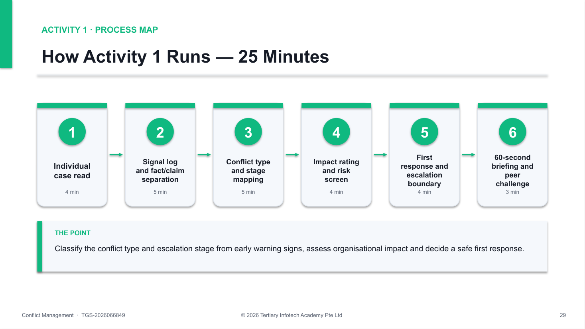
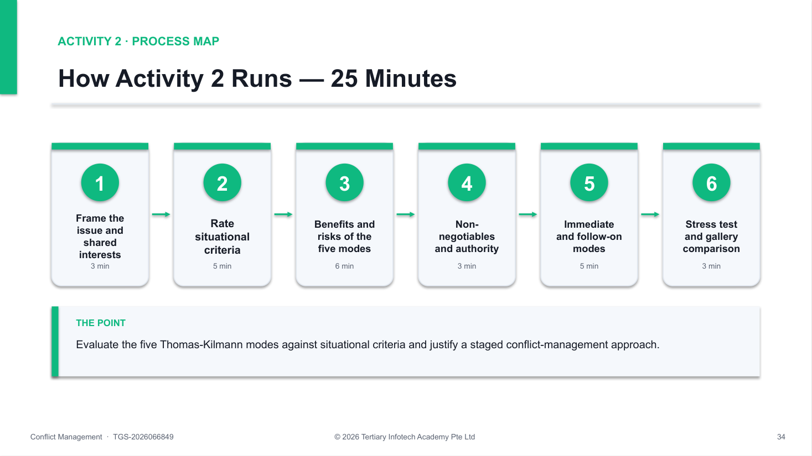
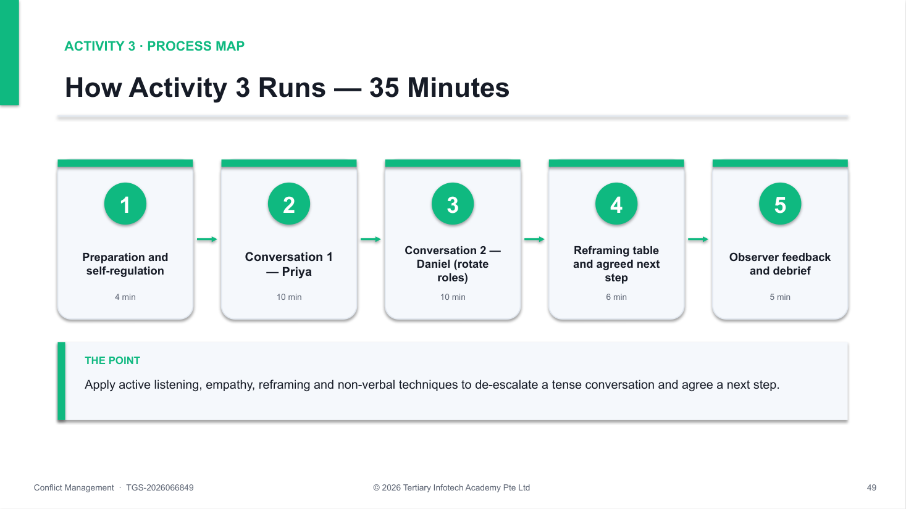
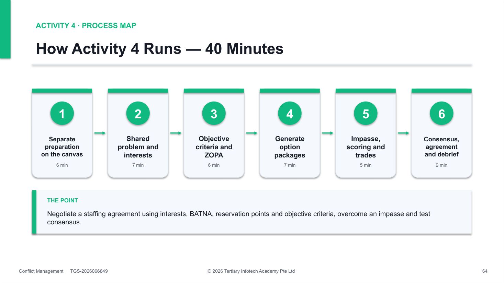
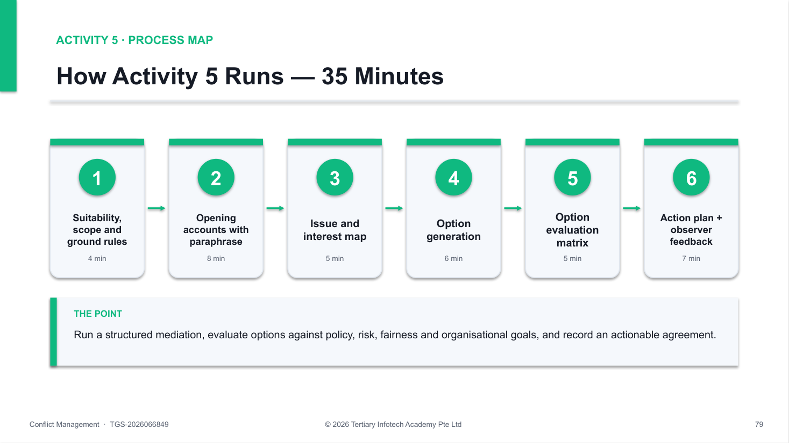
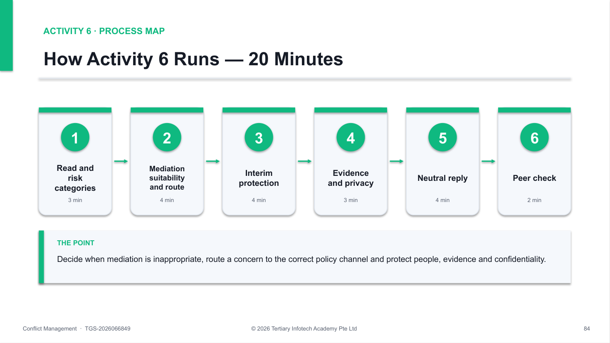
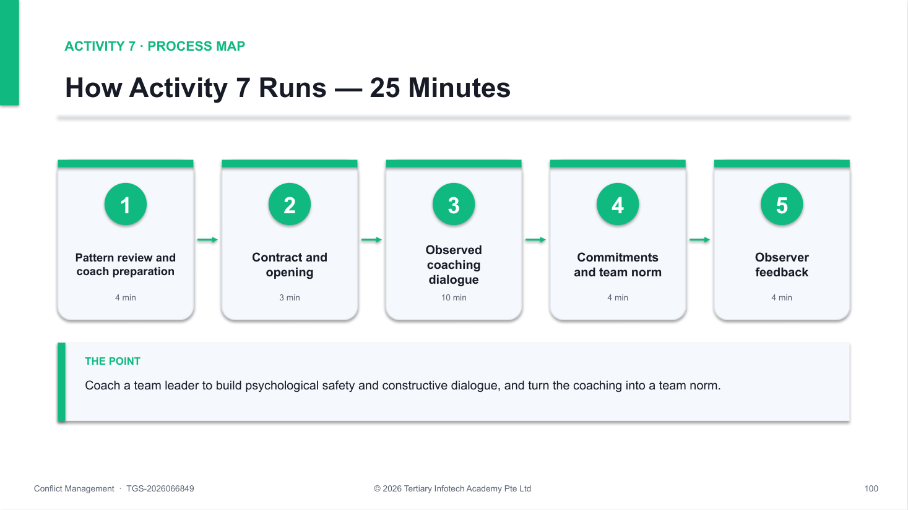
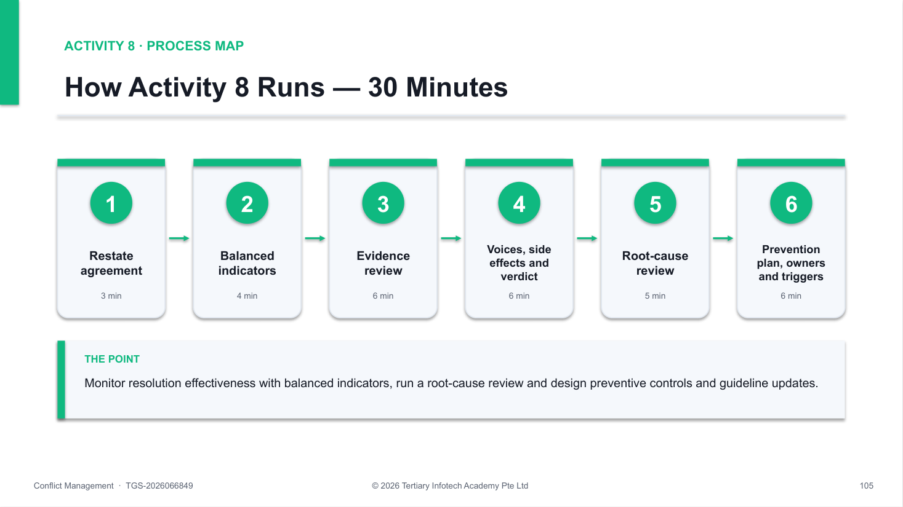

# Conflict Management — Learner Guide

**WSQ Course Code:** TGS-2026066849  |  **Conducted by:** Tertiary Infotech Academy Pte Ltd (UEN 201200696W)  |  **Version 1.0 · 19 October 2026**

## Document Version Control Record

| Version Number | Effective Date of Release | Summary of Included Changes | Author |
|---|---|---|---|
| 1.0 | 19 October 2026 | Initial release — Learner Guide for the one-day Conflict Management course (TGS-2026066849), aligned to the five learning outcomes of the revised Course Proposal. Eight workplace activities with full scenarios, role cards, step-by-step procedures, timing, self-checks and debrief standards. | Tertiary Infotech Academy Pte Ltd |

## Contents

- [How to Use This Guide](#how-to-use-this-guide)
- [Course Learning Outcomes](#course-learning-outcomes)
- [The Conflict Management Playbook](#the-conflict-management-playbook)
- [Core Dos and Don'ts](#core-dos-and-donts)
- [Resolution Route Decision Guide](#resolution-route-decision-guide)
- [Course Schedule](#course-schedule)
- [Topic 1 — Understanding Workplace Conflict and Management Styles](#topic-1--understanding-workplace-conflict-and-management-styles)
  - [Topic 1 Key Concepts](#topic-1-key-concepts)
  - [Topic 1 Concepts in Depth](#topic-1-concepts-in-depth)
  - [Activity 1 — Conflict Signal Triage at LionCity Retail](#activity-1--conflict-signal-triage-at-lioncity-retail)
  - [Activity 2 — Conflict Style Choice Clinic at BrightWorks Digital](#activity-2--conflict-style-choice-clinic-at-brightworks-digital)
- [Topic 2 — Communication Techniques for Diffusing Tensions](#topic-2--communication-techniques-for-diffusing-tensions)
  - [Topic 2 Key Concepts](#topic-2-key-concepts)
  - [Topic 2 Concepts in Depth](#topic-2-concepts-in-depth)
  - [Activity 3 — Active Listening and Reframing at HarborLink Logistics](#activity-3--active-listening-and-reframing-at-harborlink-logistics)
- [Topic 3 — Negotiation and Consensus-Building Strategies](#topic-3--negotiation-and-consensus-building-strategies)
  - [Topic 3 Key Concepts](#topic-3-key-concepts)
  - [Topic 3 Concepts in Depth](#topic-3-concepts-in-depth)
  - [Activity 4 — Interest-Based Negotiation at CarePoint Clinics](#activity-4--interest-based-negotiation-at-carepoint-clinics)
- [Topic 4 — Achieving Resolution and Protecting Organisational Interests](#topic-4--achieving-resolution-and-protecting-organisational-interests)
  - [Topic 4 Key Concepts](#topic-4-key-concepts)
  - [Topic 4 Concepts in Depth](#topic-4-concepts-in-depth)
  - [Activity 5 — Mediated Conversation at Mosaic Creative](#activity-5--mediated-conversation-at-mosaic-creative)
  - [Activity 6 — Policy, Ethics and Escalation at Meridian Hospitality](#activity-6--policy-ethics-and-escalation-at-meridian-hospitality)
- [Topic 5 — Sustaining a Conflict-Resilient Organisation](#topic-5--sustaining-a-conflict-resilient-organisation)
  - [Topic 5 Key Concepts](#topic-5-key-concepts)
  - [Topic 5 Concepts in Depth](#topic-5-concepts-in-depth)
  - [Activity 7 — Leader Coaching Huddle at NovaTech Services](#activity-7--leader-coaching-huddle-at-novatech-services)
  - [Activity 8 — 30-Day Resolution Review at GreenGrid Engineering](#activity-8--30-day-resolution-review-at-greengrid-engineering)
- [Quick Reference — Activities by Topic](#quick-reference--activities-by-topic)
- [Assessment](#assessment)
  - [Assessment Flow](#assessment-flow)
- [Glossary](#glossary)
- [Sources and Further Reading](#sources-and-further-reading)
- [Support](#support)

## How to Use This Guide

This Learner Guide accompanies the course Conflict Management (TGS-2026066849), conducted by Tertiary Infotech Academy Pte Ltd. It supports the skill 'Conflict Management' across five topics — one per learning outcome — and eight connected workplace activities.

Use it alongside the course slides during class and again during the open-book Written Assessment. Each topic lists its sub-topics and key concepts, explains the concepts in depth with the same tables and models shown on the slides, and then gives every activity in full: the scenario, the roles, a detailed step-by-step procedure, a suggested timing, the artefact you produce, a self-check list, discussion prompts and the debrief standard.

The slides carry the scenario and the structure; the detailed steps live here and in the self-contained activity packs in the labs/ folder of the course repository. The cases are fictional — never disclose a real colleague's conflict, and any participant may pause or switch roles at any time. This guide gives management guidance, not legal advice.

Before you start you will need:

- A notebook or approved digital document for your activity work.
- The activity pack (instructions, worksheet, checklist) for each activity — printed or on screen.
- Your organisation's grievance, conduct, harassment and data-handling policies, where available.
- The course slides downloaded from the LMS (https://lms-tms.tertiaryinfotech.com/).

## Course Learning Outcomes

- LO1: Analyse workplace conflict types, escalation stages, and management styles to select appropriate conflict resolution approaches for organisational settings.
- LO2: Apply active listening, empathy, reframing, and non-verbal communication techniques to de-escalate and manage conflict conversations effectively.
- LO3: Apply interest-based negotiation and consensus-building techniques to facilitate collaborative problem-solving and overcome resistance among conflicting parties.
- LO4: Evaluate and apply structured conflict resolution and mediation frameworks to develop actionable plans aligned with organisational goals.
- LO5: Develop organisational guidelines and leadership strategies to prevent recurring conflicts and embed constructive conflict management practices.

## The Conflict Management Playbook

Use this sequence before, during and after handling any workplace conflict. Each topic in this course practises one move.

1. **Recognise (Topic 1)** — Classify the conflict type and escalation stage from observable signals, assess impact and choose a fitting management style.
2. **Regulate (Topic 2)** — Manage your own reaction, listen actively, reflect emotion and reframe blame to de-escalate.
3. **Negotiate (Topic 3)** — Explore interests, know your BATNA and reservation point, generate packages and test consensus.
4. **Resolve (Topic 4)** — Run a structured resolution or mediation, evaluate options against policy and goals, and agree an action plan.
5. **Prevent (Topic 5)** — Set guidelines and escalation protocols, lead for psychological safety, monitor indicators and fix root causes.

## Core Dos and Don'ts

| Area | Don't | Do |
|---|---|---|
| Diagnosis | Label a person or choose a side from one account | Separate facts, claims, interpretations and unknowns |
| Emotion | React while flooded or demand instant calm | Pause where safe, acknowledge emotion, return at an agreed time |
| Listening | Prepare a rebuttal while the other speaks | Paraphrase facts, reflect feelings, check understanding |
| Style | Use the same mode for every conflict | Match the mode to safety, stakes, relationship, power, time and authority |
| Negotiation | Split the difference before exploring interests | Generate packages and test them against objective criteria |
| Agreement | Rely on vague promises to 'communicate better' | Record observable actions, owners, dates, evidence and a review point |
| Review | Assume silence means the issue is solved | Monitor balanced indicators and fix system causes |

## Resolution Route Decision Guide

Use organisational policy and professional advice for real cases. This guide supports management judgement and does not provide legal advice.

| Route | Useful when | Essential boundary |
|---|---|---|
| Direct conversation | The issue is safe, specific and both can participate freely | Prepare, regulate, use behaviour-impact language, record commitments |
| Facilitation | A neutral process owner can improve structure and voice | The facilitator manages the process, not a preferred outcome |
| Negotiation | Resources, schedules or responsibilities can be exchanged | Use interests, objective criteria, authority and a no-agreement plan |
| Mediation | Parties consent and need help to reach their own agreement | Screen safety, power and formal-process boundaries first |
| Coaching | A leader must build a team member's capability and accountability | Never use coaching to bypass grievance, safety or misconduct procedures |
| Formal process | Harassment, discrimination, threats or serious misconduct may be involved | Protect people, preserve evidence, impartial fact-finding, need-to-know confidentiality |

## Course Schedule

| Time | Duration | Session |
|---|---|---|
| 9:00am–9:15am | 15 min | Welcome, introductions, ground rules, learning outcomes and mandatory AM digital attendance |
| 9:15am–10:30am | 75 min | Topic 1 — Understanding Workplace Conflict and Management Styles: conflict types, escalation cycle, warning signs, Thomas-Kilmann modes. Activity 1 — Conflict Signal Triage at LionCity Retail; Activity 2 — Conflict Style Choice Clinic at BrightWorks Digital |
| 10:30am–10:40am | 10 min | Tea break |
| 10:40am–11:55am | 75 min | Topic 2 — Communication Techniques for Diffusing Tensions: active listening, empathy, reframing, non-verbal cues, de-escalation. Activity 3 — Active Listening and Reframing at HarborLink Logistics |
| 11:55am–12:30pm | 35 min | Topic 3 (part 1) — Negotiation and Consensus-Building: positions and interests, BATNA, reservation points, ZOPA, option generation |
| 12:30pm–1:30pm | 60 min | Lunch break |
| 1:30pm–2:10pm | 40 min | Topic 3 (part 2) — Activity 4 — Interest-Based Negotiation at CarePoint Clinics: resistance, impasse, consensus testing and agreement wording. PM digital attendance |
| 2:10pm–3:25pm | 75 min | Topic 4 — Achieving Resolution and Protecting Organisational Interests: structured resolution, mediation, option evaluation, action planning. Activity 5 — Mediated Conversation at Mosaic Creative; Activity 6 — Policy, Ethics and Escalation at Meridian Hospitality |
| 3:25pm–3:35pm | 10 min | Tea break |
| 3:35pm–4:50pm | 75 min | Topic 5 — Sustaining a Conflict-Resilient Organisation: guidelines, escalation protocols, psychological safety, root-cause review, monitoring. Activity 7 — Leader Coaching Huddle at NovaTech Services; Activity 8 — 30-Day Resolution Review at GreenGrid Engineering |
| 4:50pm–5:00pm | 10 min | Course wrap-up, briefing for assessment, TRAQOM and assessment digital attendance |
| 5:00pm–5:30pm | 30 min | Written Assessment (WA) — open-ended short-answer questions on LO1 and LO5, 30 minutes, open book |
| 5:30pm–6:00pm | 30 min | Live Role Play (RP) — individual observed role play on LO2, LO3 and LO4, 30 minutes |

## Topic 1 — Understanding Workplace Conflict and Management Styles

LO1: Analyse workplace conflict types, escalation stages, and management styles to select appropriate conflict resolution approaches for organisational settings.

#### Sub-topics

- Sources and types of workplace conflict: task, process, relationship and values conflict
- Conflict escalation cycle, triggers, warning signs and organisational impact
- Thomas-Kilmann conflict modes: competing, collaborating, compromising, avoiding and accommodating
- Situational criteria for selecting an appropriate conflict management approach

### Topic 1 Key Concepts

- **Conflict is a perceived threat** — Conflict arises when a party perceives that important goals, interests, values, roles or resources are blocked — disagreement alone is not conflict.
- **Four conflict types** — Task (what to do), process (how and who), relationship (how we treat each other) and values (what matters). Most real cases mix types.
- **Escalation cycle** — Latent conditions become perceived, then felt, then manifest behaviour; the aftermath either repairs or reinforces the pattern.
- **Early warning signs** — Silence, side-channel messages, missed handoffs, rework, withdrawal, complaints and declining service are data, not proof of blame.
- **Thomas-Kilmann modes** — Competing, collaborating, compromising, avoiding and accommodating sit on two axes: assertiveness and cooperativeness.
- **Choose by situation** — Select the mode from safety, stakes, relationship, power and voice, time and authority — never from habit or preference.

### Topic 1 Concepts in Depth

#### Four Types of Workplace Conflict

| Type | What it is about | Typical early signal | Useful first move |
|---|---|---|---|
| Task | What the work should be — goals, priorities, quality | Repeated debate on direction; rework | Clarify the goal and the evidence |
| Process | How and by whom — roles, handoffs, decision rights | Missed handoffs; 'not my job' | Map the workflow and decision rights |
| Relationship | How people treat each other — trust, respect | Avoidance, sarcasm, side channels | Separate people from the problem |
| Values | What matters — ethics, identity, fairness | Moral language; 'it's a matter of principle' | Find shared higher goals; respect limits |

> **When it matters:** Most real cases mix types. A process gap (no roster record) often grows into a relationship conflict — fix the process and the relationship can recover.

#### Conflict Is Data Before It Becomes Damage

- **Communication** — Silence, interruptions, sarcasm, messages that bypass normal channels.
- **Coordination** — Missed handoffs, duplicated work, withheld information, reversed decisions.
- **People** — Withdrawal, visible stress, cliques, absenteeism, requests to change teams.
- **Performance** — Rework, delays, quality escapes, declining output.
- **Customers** — Complaints, returned handoffs, inconsistent service.
- **Risk** — Threats, harassment, discrimination or retaliation — escalate under policy.

#### The Conflict Escalation Cycle

1. **Latent** — Scarce resources, roles
2. **Perceived** — A threat is recognised
3. **Felt** — Stress, anger, fear
4. **Manifest** — Behaviour others can see
5. **Aftermath** — Repair or reinforce

> **Why it matters:** A trigger — a public remark, an unfair roster, a missed deadline — moves conflict up a stage. Intervene at the earliest stage that evidence and safety allow.

#### Thomas-Kilmann Modes on Two Dimensions

|  | Assertiveness (concern for own goals) | Cooperativeness (concern for others) |
|---|---|---|
| Competing | 5 | 1 |
| Collaborating | 5 | 5 |
| Compromising | 3 | 3 |
| Avoiding | 1 | 1 |
| Accommodating | 1 | 5 |

> **What the data shows:** Relative position of each mode on the Thomas-Kilmann model (1 = low, 5 = high) — not a measured score. Every mode is useful somewhere; the skill is choosing deliberately rather than defaulting to your favourite.

#### Five Modes — Use Well, Overuse Badly

| Mode | Helpful when… | Costly when overused… |
|---|---|---|
| Competing | Urgent safety or a non-negotiable standard | Used to protect ego or silence dissent |
| Collaborating | Important, interdependent issue with time | Applied to trivial issues — burns time |
| Compromising | Time pressure, equal power, divisible issue | Splits value before interests are explored |
| Avoiding | Cooling off; issue is trivial or not yours | A recurring fairness problem is ignored |
| Accommodating | Low-value preference; goodwill matters | Resentment builds; your needs disappear |

#### Selecting an Appropriate Approach

Decision question: Urgent safety risk or a non-negotiable standard?

- **YES — compete within authority, then collaborate** — Decide now to protect people or the standard; afterwards collaborate on the follow-up so the relationship is repaired.
- **NO — score the situation** — High stakes + high relationship → collaborate. Time-critical, equal power → compromise. Low stakes → accommodate. Emotions high → avoid briefly, then return.

> **Note:** Situational criteria: safety · stakes · relationship · power and voice · time · authority. Score them before you choose a mode.

> **Why it matters:** Diagnose the conflict before you choose the style. Type and stage tell you what is happening; situational criteria tell you which mode fits.

### Activity 1 — Conflict Signal Triage at LionCity Retail

Goal: Classify the conflict type and escalation stage from early warning signs, assess organisational impact and decide a safe first response.

Method: Case study · small-group analysis · Duration: 25 minutes · Activity pack: labs/Activity-01-Conflict-Signal-Triage-at-LionCity-Retail/

#### Scenario

LionCity Retail's Orchard service team is preparing for a major promotion. Over three weeks, two experienced staff have repeatedly swapped shifts, team huddles have become quiet, and four customer handoffs were returned for missing information.

Aisha privately tells supervisor Marcus that weekend duties are being allocated unfairly. Ben, the roster coordinator, says Aisha is refusing to cooperate. Marcus has only fragments of chat messages and no agreed roster-change record. The promotion starts in five days.

#### You'll produce

A signal log, a conflict-type and escalation-stage map, and a first-response decision with an escalation boundary.  Materials: Signal log · conflict-type and stage map · triage matrix.

#### Roles

Assign one role per participant (or per small group). Give each role-player only their own card.

| Role | Goal | Brief |
|---|---|---|
| Marcus · Supervisor | Protect service continuity and fairness. | Must decide what to clarify now and what requires escalation. |
| Aisha · Senior Associate | Be heard without retaliation. | Believes a pattern — not one incident — shows unfair weekend allocation. |
| Ben · Roster Coordinator | Defend operational decisions. | Says roster changes followed availability and were not personal. |

#### Workflow

*Activity 1 workflow — the same process map the trainer shows on the slides.*

#### How to run it — step by step

1. **Read for observable facts** — Read the case once without discussing blame. Underline only what a person could directly see, hear, count or verify in a record.
2. **Separate claims and interpretations** — Move reported claims to a second column and interpretations to a third. Rewrite labels such as 'uncooperative' as specific behaviour, context and frequency.
3. **Classify the conflict type** — Decide whether each strand is task, process, relationship or values conflict. Note where types overlap — for example a process gap (no roster-change record) feeding a relationship strain.
4. **Map the escalation stage** — Place the signals on the latent, perceived, felt and manifest stages and name the trigger that moved the conflict forward. Mark missing evidence as unknown.
5. **Assess organisational impact** — Rate the current impact on people, work, customers and risk as low, medium or high, with one sentence of evidence for each rating.
6. **Screen immediate risk** — Check for safety threats, harassment, discrimination, retaliation or serious misconduct. If any is present, stop informal handling and follow policy.
7. **Select the first response** — Choose the least intrusive safe response — monitor, clarify separately, structured conversation, facilitation or formal escalation — and name the owner and deadline.
8. **Set the escalation boundary and brief** — Write the trigger that would move the matter to HR or the grievance channel, then prepare a 60-second briefing that explains the decision without diagnosing anyone's personality.

#### Suggested timing

| Minutes | Phase |
|---|---|
| 4 min | Individual case read |
| 5 min | Signal log and fact/claim separation |
| 5 min | Conflict type and stage mapping |
| 4 min | Impact rating and risk screen |
| 4 min | First response and escalation boundary |
| 3 min | 60-second briefing and peer challenge |
| 25 min | Total |

> **✅ Test it — before you debrief, check that:**
>
> - [ ] Observable facts, reported claims, interpretations and unknowns are visibly separated.
> - [ ] Each conflict strand is classified as task, process, relationship or values, with overlaps noted.
> - [ ] The escalation stage and the trigger are supported by evidence from the case.
> - [ ] Safety, harassment, discrimination, retaliation and misconduct risks were screened.
> - [ ] The first action names an owner and deadline and is proportionate to the current risk.

#### Discussion and decision prompts

- Which details are observable facts, reported claims and interpretations?
- Which conflict types are present, and which one is driving the others?
- What indicators suggest latent, perceived, felt or manifest conflict?
- What would make informal clarification unsafe or inappropriate?

#### Reflect

- Did you avoid diagnosing personality from limited evidence?
- Did your first response name an owner, deadline and escalation boundary?

#### If you get stuck

| Symptom | What to do |
|---|---|
| Everything looks like 'attitude' | Ask: what would a camera have recorded? Rewrite each label as behaviour, context and frequency. |
| Group jumps to a joint meeting | Re-run the risk screen. A joint meeting is unsafe if retaliation or power concerns are unresolved. |
| Stage is unclear | Stages overlap. Record the earliest stage with evidence and the trigger that would move it forward. |

> **Debrief standard:** The triage separates facts from assumptions, classifies type and stage with evidence, screens policy risk and selects a proportionate next action.

### Activity 2 — Conflict Style Choice Clinic at BrightWorks Digital

Goal: Evaluate the five Thomas-Kilmann modes against situational criteria and justify a staged conflict-management approach.

Method: Case study · decision clinic · Duration: 25 minutes · Activity pack: labs/Activity-02-Conflict-Style-Choice-Clinic-at-BrightWorks-Digital/

#### Scenario

BrightWorks Digital's product and sales teams disagree about releasing a feature before security testing is complete. Sales has promised a launch date to a key client; Product says the unresolved issue may expose customer data.

The CEO wants a decision today, but both teams must work closely together for the next six months. Learners assess all five conflict-handling modes and recommend a staged response rather than declaring one style universally best.

#### You'll produce

A Thomas-Kilmann style decision matrix with a staged response rationale (today and the next two weeks).  Materials: Style decision matrix · situational criteria scorecard.

#### Roles

Assign one role per participant (or per small group). Give each role-player only their own card.

| Role | Goal | Brief |
|---|---|---|
| Head of Sales | Keep the client's trust and the revenue commitment. | Under pressure from the account manager; open to a phased release if the client is informed early. |
| Product Lead | Protect customer data and product quality. | Will not release with an unresolved data-exposure risk; can scope a reduced feature set. |
| Facilitator · COO | Reach a defensible decision and preserve collaboration. | Has authority to decide today; must ensure both teams' expertise is heard. |

#### Workflow

*Activity 2 workflow — the same process map the trainer shows on the slides.*

#### How to run it — step by step

1. **Frame the issue** — State the decision in one neutral sentence and list the shared interests: client trust, product value, data security and continued collaboration.
2. **Rate the situational criteria** — Score safety, stakes, relationship importance, power and voice, time pressure and decision authority as low, medium or high, citing case evidence.
3. **Review the five modes** — For competing, collaborating, compromising, avoiding and accommodating, write one potential benefit and one risk in this case.
4. **Identify non-negotiables** — Name any legal, ethical, safety, security or policy threshold that cannot be traded for speed or harmony.
5. **Choose the immediate mode** — Select the approach for today's deadline and explain who has authority and how dissenting expertise will still be heard.
6. **Choose the follow-on mode** — Select the approach for the next two weeks so the urgent decision does not become the whole resolution.
7. **Protect voice** — Add a mechanism for technical and commercial concerns to be raised without retaliation or domination by job title.
8. **Stress-test and compare** — Test the plan against 'the client refuses a delay' and 'the CEO insists on release', then compare with another group to spot where personal preference replaced situational judgement.

#### Suggested timing

| Minutes | Phase |
|---|---|
| 3 min | Frame the issue and shared interests |
| 5 min | Rate situational criteria |
| 6 min | Benefits and risks of the five modes |
| 3 min | Non-negotiables and authority |
| 5 min | Immediate and follow-on modes |
| 3 min | Stress test and gallery comparison |
| 25 min | Total |

> **✅ Test it — before you debrief, check that:**
>
> - [ ] All five Thomas-Kilmann modes were evaluated with a benefit and a risk.
> - [ ] The recommendation is tied to safety, stakes, relationship, power, time and authority.
> - [ ] Non-negotiable standards are not treated as bargaining chips.
> - [ ] The response separates the urgent decision from the longer-term resolution.
> - [ ] A voice safeguard and a review point are included.

#### Discussion and decision prompts

- Which part of the issue is non-negotiable, and who has authority to decide it?
- Where would collaborating add value after the immediate decision?
- What power imbalance or voice risk must the facilitator manage?
- What temporary agreement could protect the client relationship without compromising security?

#### Reflect

- Did you distinguish a short-term emergency response from long-term resolution?
- Did you name the risks of overusing your own preferred style?

#### If you get stuck

| Symptom | What to do |
|---|---|
| 'Collaborate' for everything | Collaboration needs time and shared goals. Ask what must be decided today and by whom. |
| Security traded for speed | Return to the non-negotiables list — a data-exposure risk is not a bargaining chip. |
| No follow-on plan | Add a second stage: who meets, when, and how the relationship cost of today's decision is repaired. |

> **Debrief standard:** The recommendation links each mode choice to evidence about safety, stakes, relationship, power, time and authority, and stages the response.

## Topic 2 — Communication Techniques for Diffusing Tensions

LO2: Apply active listening, empathy, reframing, and non-verbal communication techniques to de-escalate and manage conflict conversations effectively.

#### Sub-topics

- Active listening, paraphrasing, questioning and summarising
- Emotional cues, empathy and perspective-taking in conflict conversations
- Reframing, neutral language and separating people from the problem
- Non-verbal communication, emotional self-regulation and de-escalation techniques

### Topic 2 Key Concepts

- **Active listening** — Attend, ask open questions, paraphrase, reflect emotion and summarise — understanding is demonstrated, not assumed.
- **Empathy is not agreement** — Validating a person's experience acknowledges it as real for them without deciding that every claim is correct.
- **Perspective-taking** — Ask what the other person sees, fears and needs; it surfaces interests that a rebuttal would bury.
- **Reframing** — Translate blame and labels into observable behaviour, impact, underlying interest and a future-focused request.
- **Non-verbal signals** — Tone, pace, posture, eye contact, proximity and silence carry most of the emotional message — align them with your words.
- **Regulation first** — Notice your own triggers, slow the pace and pause where safe — a flooded brain cannot problem-solve.

### Topic 2 Concepts in Depth

#### The Active Listening Loop

1. **Attend** — Posture, eyes, silence
2. **Ask open** — What, how, walk me through
3. **Paraphrase** — Facts in your own words
4. **Reflect emotion** — Name it tentatively
5. **Summarise** — Interests and next step

> **Check, don't assume:** Each loop ends with a check — 'Have I got that right?' Understanding is something you demonstrate, not something you claim.

#### Questions That Open vs Questions That Close

| Closing / accusatory | Open / exploratory | Why it works |
|---|---|---|
| Why did you ignore the procedure? | Walk me through the handoff from your side. | Invites an account, not a defence |
| Who started this? | What happened just before the argument? | Explores sequence, not blame |
| Don't you think Priya overreacted? | What impact did this have on your work? | Neutral — no leading premise |
| Can you prove you are right? | What would a workable week look like for you? | Moves to interests and future |

#### Empathy and Perspective-Taking

- **Notice emotional cues** — Pace, volume, word choice and what is not said signal the emotion behind the words.
- **Validate, don't verdict** — 'That sounds frustrating' acknowledges experience without agreeing with every claim.
- **Take their perspective** — Ask: what do they see, fear and need? Write it in their words before your own.
- **Check your own story** — Separate what you observed from the motive you assumed.

#### Reframing Blame into Interests

| Escalating statement | Neutral reframe | Interest surfaced |
|---|---|---|
| He keeps changing priorities without warning. | Priorities changed late without notice to the pickers. | Predictability and safe planning |
| Her team hides delays. | Picking delays become visible only late in the day. | Early warning to protect customers |
| Taylor shoots down everything I say. | You need to finish presenting before critique starts. | Fair hearing for ideas |
| This always happens. | This has happened three times this month. | A pattern worth fixing |

> **When it matters:** Separate the person from the problem: describe the behaviour and its impact, never the character.

#### Non-Verbal Communication in Conflict

- **Posture** — Open, seated, angled slightly — not squared off or towering.
- **Eye contact** — Steady but soft; culturally sensitive, never a stare-down.
- **Tone and pace** — Lower and slower than theirs pulls the conversation down.
- **Space** — Respect personal distance; sit side-by-side on shared documents.
- **Face and hands** — Relaxed face, visible hands; no eye-rolling or pointing.
- **Silence** — A pause lets emotion settle and invites the other person to continue.

#### A De-escalation Sequence

1. **Regulate yourself** — Breathe, slow down
2. **Acknowledge** — Name the emotion
3. **Create space** — Pause, sit, lower volume
4. **Separate** — Person from problem
5. **Agree next step** — Small and specific

> **Safety first:** If there is any threat of harm, stop the conversation, protect people and follow the safety procedure — de-escalation is not a substitute.

> **Why it matters:** Regulation precedes resolution. A calm, heard person can problem-solve. A flooded, defended one cannot — listen first.

### Activity 3 — Active Listening and Reframing at HarborLink Logistics

Goal: Apply active listening, empathy, reframing and non-verbal techniques to de-escalate a tense conversation and agree a next step.

Method: Role play · triads with observer · Duration: 35 minutes · Activity pack: labs/Activity-03-Active-Listening-and-Reframing-at-HarborLink-Logistics/

#### Scenario

At HarborLink Logistics, warehouse lead Priya raised her voice at transport planner Daniel during the morning huddle, saying he 'keeps changing dispatch priorities without warning'. Daniel replied that Priya's team 'hides picking delays until late afternoon' and walked out.

Operations supervisor Siew Ling meets each of them separately the same morning. The shared dashboard records timestamps but not who approved priority changes. Siew Ling's goal is not to decide who is right, but to lower the temperature, understand each person's interests and agree a calm next step.

#### You'll produce

A listening log with paraphrases, emotion reflections and reframes, plus an observer's de-escalation sheet and an agreed next step.  Materials: Listening log · reframing table · non-verbal observation sheet.

#### Roles

Assign one role per participant (or per small group). Give each role-player only their own card.

| Role | Goal | Brief |
|---|---|---|
| Siew Ling · Operations Supervisor | Lower the temperature and understand both sides. | Listens, paraphrases, reflects emotion, reframes blame and agrees a next step — without taking sides. |
| Priya · Warehouse Lead | Be taken seriously about last-minute changes. | Frustrated and embarrassed about raising her voice; worried about overtime and safe picking. |
| Daniel · Transport Planner | Meet urgent delivery commitments. | Feels blamed in public; has three customer escalations this week and believes delays are hidden. |
| Observer | Give evidence-based feedback. | Logs listening moves and non-verbal cues — tone, pace, posture, eye contact, interruptions. |

#### Workflow

*Activity 3 workflow — the same process map the trainer shows on the slides.*

#### How to run it — step by step

1. **Prepare yourself** — Siew Ling notes her own reaction to the incident, chooses a private seated setting, sets a 10-minute window and plans an open, relaxed posture.
2. **Open neutrally** — State the purpose (understand what happened and agree a next step), respectful conduct and the limits of confidentiality. Avoid any verdict.
3. **Invite the account** — Ask one open question — 'Walk me through this morning from your side' — then listen for two minutes without interrupting, using minimal encouragers.
4. **Paraphrase the content** — Restate the facts in your own words and check: 'So the priorities changed twice after 10am and nobody told the pickers — have I got that right?'
5. **Reflect the emotion** — Name the feeling tentatively and validate it without agreeing with every claim: 'It sounds frustrating to be blamed for delays you didn't cause.'
6. **Explore with open questions** — Ask about impact, needs and perspective: 'What do you need from transport to plan picking safely?' 'How might Daniel be seeing this?'
7. **Reframe blame into interests** — Convert accusations into behaviour, impact, interest and request, and record each pair in the reframing table.
8. **Watch and adjust non-verbal cues** — The observer signals if tone, pace, posture or eye contact escalate; the listener slows down, lowers volume and leaves silence.
9. **Summarise and agree a next step** — Summarise interests and agree one concrete next step — for example a 15-minute joint check-in with a shared change-log template.
10. **Rotate and debrief** — Repeat with Daniel (new listener), then the observer gives one strong move and one missed opportunity per conversation.

#### Suggested timing

| Minutes | Phase |
|---|---|
| 4 min | Preparation and self-regulation |
| 10 min | Conversation 1 — Priya |
| 10 min | Conversation 2 — Daniel (rotate roles) |
| 6 min | Reframing table and agreed next step |
| 5 min | Observer feedback and debrief |
| 35 min | Total |

> **✅ Test it — before you debrief, check that:**
>
> - [ ] Each conversation opened neutrally with purpose, conduct and confidentiality limits.
> - [ ] At least two accurate paraphrases and one emotion reflection were checked with the speaker.
> - [ ] Open questions explored impact, needs and the other party's perspective.
> - [ ] At least three accusations were reframed into behaviour, impact, interest and request.
> - [ ] Non-verbal cues were observed and adjusted, and a concrete next step was agreed.

#### Discussion and decision prompts

- Which listening move lowered the temperature most, and why?
- How did you validate emotion without agreeing with every claim?
- Which reframe turned blame into a shared problem?
- What non-verbal signals escalated or calmed the conversation?

#### Reflect

- Did the listener talk less than the speaker?
- Did the next step address both parties' interests, not just one?

#### If you get stuck

| Symptom | What to do |
|---|---|
| Listener starts problem-solving | Pause. Paraphrase and reflect first — solutions offered too early sound like a verdict. |
| Speaker escalates | Lower volume and pace, acknowledge the emotion, offer a short pause; do not argue facts while flooded. |
| Reframe sounds like spin | Keep the speaker's meaning. A reframe names their real need, not a softer version of what you prefer. |

> **Debrief standard:** Both conversations show accurate paraphrasing, emotion reflection, neutral reframes and calm non-verbal behaviour, ending with an agreed, specific next step.

## Topic 3 — Negotiation and Consensus-Building Strategies

LO3: Apply interest-based negotiation and consensus-building techniques to facilitate collaborative problem-solving and overcome resistance among conflicting parties.

#### Sub-topics

- Positions, interests and needs in interest-based negotiation
- BATNA, reservation points and zones of possible agreement
- Collaborative problem-solving and option-generation techniques
- Managing resistance, power imbalances and negotiation impasses
- Consensus testing, agreement wording and commitment building

### Topic 3 Key Concepts

- **Positions vs interests** — A position is the demand; the interest is the reason. Interests are usually more numerous and more compatible than positions.
- **BATNA** — Your Best Alternative To a Negotiated Agreement — what you will do if talks fail. It sets your real negotiating power.
- **Reservation point & ZOPA** — The reservation point is the worst deal you would accept; the Zone of Possible Agreement is where both parties' limits overlap.
- **Expand before you divide** — Generate several packages that trade across differing priorities before anyone evaluates or concedes.
- **Resistance and power** — Name the impasse, return to interests and objective criteria, and protect the voice of the less powerful party.
- **Consensus and commitment** — Test agreement explicitly, word it as specific actions, owners and dates, and secure visible commitment.

### Topic 3 Concepts in Depth

#### Position Bargaining vs Interest-Based Negotiation

| Dimension | Position bargaining | Interest-based negotiation |
|---|---|---|
| Focus | Argues for a fixed demand | Explores needs and constraints beneath it |
| Value | Treats every concession as a loss | Trades across differing priorities |
| Basis | Power, pressure, persistence | Objective criteria and evidence |
| Relationship | Often damaged | Protected for future work |
| Outcome | Split the difference | Packages that meet more interests |

#### BATNA, Reservation Point and ZOPA

- **Position** — The stated demand — 'two extra nurses per session'.
- **Interest** — The reason underneath — patient safety, staff recovery, budget.
- **BATNA** — Best Alternative To a Negotiated Agreement — what you do if talks fail.
- **Reservation point** — The worst deal you will accept before walking away to your BATNA.
- **ZOPA** — Zone of Possible Agreement — where both reservation points overlap.
- **Power** — The stronger your BATNA, the less you need any particular deal.

#### Worked Example — Finding the ZOPA at CarePoint

|  | Extra nurse-hours (3 Saturday sessions) |
|---|---|
| Mei's opening position | 36 |
| Arjun's reservation point | 30 |
| Mei's reservation point | 27 |
| Arjun's opening position | 18 |

> **What the data shows:** Openings are 18 vs 36 hours — far apart. But Mei can accept 27 and Arjun can approve up to 30, so a ZOPA of 27–30 nurse-hours exists. Interests and criteria help both find it.

#### Interest-Based Negotiation in Five Moves

1. **Prepare** — Interests, BATNA, limits
2. **Open** — Shared problem statement
3. **Explore** — Ask, paraphrase, criteria
4. **Create** — Three or more packages
5. **Close** — Test, word, commit

> **Expand before you divide:** Generate options before evaluating them — brainstorming and evaluation in the same breath kills creativity.

#### Overcoming Resistance, Power Imbalance and Impasse

- **Name the impasse** — 'We seem stuck on the budget — can we step back to what each of us needs?'
- **Return to criteria** — Ask which objective standard would make an option fair to both sides.
- **Make it conditional** — Pilot, phase or trigger-based commitments lower the risk of saying yes.
- **Balance power** — Time-box turns, invite the quieter party, check authority on both sides.
- **Take a break** — A short pause resets emotion; agree exactly when you will resume.
- **Know your BATNA** — If no ZOPA exists, escalate with data rather than concede below your limit.

#### Testing Consensus — Gradients of Agreement

| Level | What the person means | What to do |
|---|---|---|
| 1 · Endorse | I fully support this | Record commitment |
| 2 · Agree | I can live with it comfortably | Record commitment |
| 3 · Reservations | I'll go along but have a concern | Ask for the concern; adjust if cheap |
| 4 · Serious concern | I need changes before I commit | Return to interests and options |
| 5 · Block | I cannot accept this | Do not close — rework or escalate |

> **When it matters:** Word the agreement as actions, owners, dates, evidence and a review trigger — then ask each party to confirm it aloud.

> **Why it matters:** Interests are compatible more often than positions. Ask why before you argue how much — then let objective criteria choose between packages.

### Activity 4 — Interest-Based Negotiation at CarePoint Clinics

Goal: Negotiate a staffing agreement using interests, BATNA, reservation points and objective criteria, overcome an impasse and test consensus.

Method: Role play · negotiation pairs with observer · Duration: 40 minutes · Activity pack: labs/Activity-04-Interest-Based-Negotiation-at-CarePoint-Clinics/

#### Scenario

CarePoint Clinics must cover three six-hour Saturday vaccination sessions during a seasonal surge. Nurse lead Mei wants two extra nurses at each session (36 extra nurse-hours); operations lead Arjun says the overtime ceiling permits only one (18 nurse-hours).

Both need safe patient care and sustainable staffing. Each receives private interests, a BATNA and a reservation point, then negotiates a package using booking forecasts, skill coverage, overtime limits and rotation history. Midway, Arjun announces that 'head office will not approve a cent more' — the pair must work through the impasse.

#### You'll produce

A negotiation canvas (positions, interests, BATNA, reservation point), an option scorecard and a consensus-tested written agreement.  Materials: Negotiation canvas · ZOPA line · option scorecard · agreement template.

#### Roles

Assign one role per participant (or per small group). Give each role-player only their own card.

| Role | Goal | Brief |
|---|---|---|
| Mei · Nurse Lead | Protect patient safety and staff recovery. | Reservation point: 27 extra nurse-hours (minimum safe coverage). BATNA: cap bookings at 75% and turn patients away. Can trade session length and skill mix, not minimum clinical coverage. |
| Arjun · Operations Lead | Stay within approved cost and service commitments. | Reservation point: 30 extra nurse-hours with evidence of demand. BATNA: hire agency nurses at about 1.6 times the cost. Can reallocate weekday hours and seek conditional approval. |
| Observer · Process Coach | Test fairness and process quality. | Tracks questions, paraphrases, criteria, options, impasse handling and how consensus was tested. |

#### Workflow

*Activity 4 workflow — the same process map the trainer shows on the slides.*

#### How to run it — step by step

1. **Prepare separately** — Each party fills in the canvas: position, underlying interests, BATNA, reservation point, evidence and what they could trade.
2. **Agree a shared problem statement** — Convert the dispute into a joint question: 'How do we cover the surge safely within a sustainable cost?'
3. **Exchange interests** — Each side explains interests and constraints; the other paraphrases before responding. No proposals yet.
4. **Agree objective criteria** — Choose criteria both accept — booking forecast, minimum clinical ratio, overtime policy, cost and fair rotation.
5. **Locate the ZOPA** — Without revealing reservation points verbatim, test ranges until both see whether an overlap exists (here 27–30 nurse-hours).
6. **Generate at least three packages** — Combine variables — session length, skill mix, weekday hour swaps, staggered start times, a pilot — before evaluating any of them.
7. **Work through the impasse** — When Arjun's 'not a cent more' lands, name the impasse, return to interests and criteria, propose a conditional or phased package, and protect Mei's voice if power tilts.
8. **Score and trade** — Rate each package against the agreed criteria; trade low-cost/high-value items without trading away safety or policy.
9. **Test consensus** — Use a gradients-of-agreement check (1 = fully endorse … 5 = cannot accept); resolve any 4–5 before closing.
10. **Word the agreement** — Record the allocation, actions, owners, dates, evidence, communication to staff and a review trigger; both parties confirm commitment.

#### Suggested timing

| Minutes | Phase |
|---|---|
| 6 min | Separate preparation on the canvas |
| 7 min | Shared problem and interests |
| 6 min | Objective criteria and ZOPA |
| 7 min | Generate option packages |
| 5 min | Impasse, scoring and trades |
| 9 min | Consensus, agreement and debrief |
| 40 min | Total |

> **✅ Test it — before you debrief, check that:**
>
> - [ ] Positions, interests, BATNA and reservation points are distinguished on the canvas.
> - [ ] Interests were exchanged and paraphrased before any proposal was made.
> - [ ] At least three packages were scored against jointly agreed objective criteria.
> - [ ] The impasse was named and worked through without trading away safety or policy.
> - [ ] Consensus was tested explicitly and the agreement names owners, dates, evidence and a review trigger.

#### Discussion and decision prompts

- What are each party's positions, interests, BATNA and reservation point?
- Is there a ZOPA — and what would you do if there were none?
- Which package trades across time, skill mix, session design and budget?
- How did you handle 'not a cent more' without escalating the conflict?

#### Reflect

- Did the parties ask enough questions before exchanging proposals?
- Did the final package meet safety, policy and authority boundaries?

#### If you get stuck

| Symptom | What to do |
|---|---|
| Splitting the difference at once | Stop. Compromise before exploring interests leaves value on the table — generate packages first. |
| No overlap found | Re-check BATNAs and add variables (timing, pilot, conditional approval); if still none, escalate with data. |
| One party dominates | Use the observer to time-box turns, paraphrase the quieter party and return to the agreed criteria. |

> **Debrief standard:** The agreement sits inside the ZOPA, explains interests, criteria and trade-offs, survived an impasse and was consensus-tested with owners, dates and a review trigger.

## Topic 4 — Achieving Resolution and Protecting Organisational Interests

LO4: Evaluate and apply structured conflict resolution and mediation frameworks to develop actionable plans aligned with organisational goals.

#### Sub-topics

- Structured conflict-resolution process: intake, issue mapping, option development and agreement
- Mediation stages, impartial facilitation and boundary management
- Evaluating resolution options against policy, risk, fairness and organisational goals
- Action planning, accountability, documentation and follow-up

### Topic 4 Key Concepts

- **Structured process** — Intake → issue mapping → option development → evaluation → agreement and follow-up keeps resolution fair and repeatable.
- **Mediator owns the process** — A mediator manages fairness, voice and structure — never the outcome. Parties craft and own their agreement.
- **Boundary management** — Check suitability, voluntariness, power and policy limits first; harassment or discrimination concerns go to the formal route.
- **Evaluate every option** — Test options against policy fit, risk, fairness to all parties and the organisation's goals — not just the parties' comfort.
- **Actionable plans** — Every agreement names the action, owner, date, evidence of progress and a review point or trigger.
- **Document proportionately** — Record what is necessary, accurate and authorised; restrict access on a need-to-know basis.

### Topic 4 Concepts in Depth

#### A Structured Conflict-Resolution Process

1. **Intake** — Concern, risk, suitability
2. **Issue mapping** — Issues and interests
3. **Option development** — Generate, then combine
4. **Evaluation** — Policy, risk, fairness
5. **Agreement** — Plan, owner, review

> **Repeatable and fair:** The same stages for every case make outcomes defensible — and stop the loudest party from setting the agenda.

#### The Stages of Mediation

1. **Cool & check** — Readiness, safety, scope
2. **Listen** — Equal uninterrupted time
3. **Explore** — Impact, interests, goals
4. **Agree** — Options, reality-test
5. **Record & review** — Owners, dates, follow-up

> **The mediator owns the process:** Parties own the outcome. A mediator who proposes the answer stops being neutral.

#### Impartial Facilitation and Boundary Management

- **Suitability** — Voluntary, no alleged harassment, discrimination or threat, workable power balance.
- **Equal voice** — Comparable time, questions and opportunity to respond.
- **Neutral language** — Balanced summaries; reframes that keep both meanings.
- **Confidentiality limits** — Explain what can and cannot be kept private — never promise total secrecy.
- **Authority limits** — Know what the organisation can offer and what needs a decision-maker.
- **Stop rules** — Pause or end if safety, coercion or a formal-process issue appears.

#### Evaluating Resolution Options

| Criterion | Question to ask | Red flag |
|---|---|---|
| Policy fit | Is it consistent with our policies and the law? | Bypasses a grievance or HR process |
| Risk | What could go wrong for safety, clients or reputation? | Shifts risk onto a third party |
| Fairness | Would a neutral observer see it as fair to both? | One party carries all the change |
| Organisational goals | Does it support service, quality and teamwork? | Solves the feeling, not the work |
| Feasibility | Can it be done with the time and resources we have? | No owner, budget or date |

#### Mediate, or Route to the Formal Process?

Decision question: Alleged harassment, discrimination, threat or serious misconduct?

- **YES — formal route under policy** — Protect people, preserve evidence, route to HR or the grievance channel, ensure non-retaliation. Do not 'clear the air'.
- **NO — mediation may fit** — If participation is voluntary and power is workable, mediate with ground rules and a written, reviewable agreement.

> **Note:** This course gives management guidance, not legal advice — apply your organisation's policy and seek professional advice for real cases.

#### Action Planning, Accountability and Documentation

- **Specific action** — An observable behaviour or change — not 'communicate better'.
- **Owner and date** — One named owner per action and a realistic deadline.
- **Evidence of progress** — What we will see if it is working.
- **Review point** — A follow-up date and the trigger for re-opening.
- **Proportionate records** — Necessary, accurate, authorised; restricted to need-to-know.
- **Follow-up** — Check in with both parties — silence is not success.

> **Why it matters:** A fair process protects the people and the organisation. Check the boundary, run the stages, evaluate against policy and goals — then write it down and review it.

### Activity 5 — Mediated Conversation at Mosaic Creative

Goal: Run a structured mediation, evaluate options against policy, risk, fairness and organisational goals, and record an actionable agreement.

Method: Role play · mediation triads with observer · Duration: 35 minutes · Activity pack: labs/Activity-05-Mediated-Conversation-at-Mosaic-Creative/

#### Scenario

At Mosaic Creative, designer Alex says reviewer Taylor undermines ideas in client-preparation meetings by interrupting with risks. Taylor says Alex dismisses feedback and presents concepts too late for proper review. Two client pitches have slipped this quarter.

Their manager Jordan will mediate. The shared goal is better client work without silencing critique. The issue is suitable for mediation: there is no allegation of harassment, discrimination or threat, and both parties agree to take part.

#### You'll produce

A mediation record (ground rules, issue map, options, evaluation matrix) and a written action plan with owners, dates, evidence and review.  Materials: Mediation record · option evaluation matrix · action-plan template · observer checklist.

#### Roles

Assign one role per participant (or per small group). Give each role-player only their own card.

| Role | Goal | Brief |
|---|---|---|
| Jordan · Mediator | Run a fair process. | Checks suitability, sets ground rules, paraphrases, reframes, reality-tests and records the agreement — never decides who is right. |
| Alex · Designer | Receive fair consideration. | Needs time to present ideas and feedback focused on the work, not competence. |
| Taylor · Reviewer | Surface risk early. | Needs concerns heard and evidence considered before client exposure. |
| Observer | Assess impartiality and structure. | Uses the checklist to track equal voice, neutrality and agreement quality. |

#### Workflow

*Activity 5 workflow — the same process map the trainer shows on the slides.*

#### How to run it — step by step

1. **Confirm suitability** — Jordan checks voluntary participation, readiness, power balance and that no allegation requires a formal process instead.
2. **State scope and limits** — Explain the mediator's neutral role, respectful conduct, note-taking and the limits of confidentiality; parties confirm the issue to discuss.
3. **Agree ground rules** — One speaker at a time, specific recent examples, no insults, permission to pause, focus on future work.
4. **Hear both accounts** — Alex then Taylor each speak for two uninterrupted minutes; Jordan paraphrases facts, feelings and needs, and the other party checks understanding.
5. **Map issues and interests** — Jordan lists the issues neutrally (timing of reviews, how critique is given) and the interests behind each position.
6. **Generate options** — Each party proposes at least two options without evaluation; Jordan adds what the organisation can support.
7. **Evaluate options** — Score options against policy fit, risk to client delivery, fairness to both parties and team goals; drop or adjust any that fail.
8. **Write the action plan** — Record the critique protocol, presentation time, language expectations, owners, dates, evidence of progress and a two-week review.
9. **Observer feedback** — The observer names one strong mediation move and one missed opportunity, and checks the plan is specific and balanced.

#### Suggested timing

| Minutes | Phase |
|---|---|
| 4 min | Suitability, scope and ground rules |
| 8 min | Opening accounts with paraphrase |
| 5 min | Issue and interest map |
| 6 min | Option generation |
| 5 min | Option evaluation matrix |
| 4 min | Action plan |
| 3 min | Observer feedback |
| 35 min | Total |

> **✅ Test it — before you debrief, check that:**
>
> - [ ] Suitability and formal-process boundaries were checked before mediating.
> - [ ] Both parties received equal uninterrupted time and comparable listening checks.
> - [ ] Issues and interests were mapped neutrally before options were generated.
> - [ ] Options were evaluated against policy, risk, fairness and organisational goals.
> - [ ] The action plan contains observable actions, owners, dates, evidence and a review point.

#### Discussion and decision prompts

- What opening establishes purpose, neutrality and the limits of confidentiality?
- How did Jordan stay impartial while validating both perspectives?
- Which option scored best against policy, risk, fairness and goals — and why?
- What would make the agreement fail, and how does the plan detect it early?

#### Reflect

- Did the mediator speak less than the parties and use balanced summaries?
- Is every commitment observable and owned?

#### If you get stuck

| Symptom | What to do |
|---|---|
| Mediator takes a side | Return to balanced summaries; give the other party comparable time and an equivalent question. |
| Options are vague | Ask 'what will we see differently at the next review?' and add an owner and date. |
| Party wants a verdict | Restate the mediator's role: the process is shared, the decision is theirs within policy limits. |

> **Debrief standard:** The mediation follows the structured stages, stays impartial, evaluates options against organisational criteria and ends with a balanced, observable action plan.

### Activity 6 — Policy, Ethics and Escalation at Meridian Hospitality

Goal: Decide when mediation is inappropriate, route a concern to the correct policy channel and protect people, evidence and confidentiality.

Method: Case study · routing decision · Duration: 20 minutes · Activity pack: labs/Activity-06-Policy-Ethics-and-Escalation-at-Meridian-Hospitality/

#### Scenario

At Meridian Hospitality, employee Farah reports that colleague Leon has repeatedly made jokes about her religion in a team chat. She fears that complaining will affect her shift allocation because Leon is close to the duty manager.

A supervisor, Ravi, suggests putting both employees in a room to 'clear the air'. Learners decide the immediate response, the authorised channel, the confidentiality boundary, interim support and documentation. This activity is educational and not legal advice.

#### You'll produce

An escalation decision record with the routing choice, interim protection plan, confidentiality boundary and a neutral acknowledgement message.  Materials: Policy-routing worksheet · evidence and privacy checklist.

#### Roles

Assign one role per participant (or per small group). Give each role-player only their own card.

| Role | Goal | Brief |
|---|---|---|
| Farah · Reporting Employee | Be safe, heard and protected from retaliation. | Wants the conduct to stop; anxious about who will see the report. |
| Ravi · Supervisor | Respond promptly within his authority. | Must not investigate beyond competence or force a face-to-face meeting. |
| HR Case Lead | Run a fair policy process. | Explains scope, privacy, support, neutral fact-finding and next updates. |

#### Workflow

*Activity 6 workflow — the same process map the trainer shows on the slides.*

#### How to run it — step by step

1. **Read without investigating** — Identify only the immediate routing decision; do not try to prove or disprove the allegation.
2. **Identify risk categories** — Mark possible harassment, discrimination, retaliation and data-protection concerns as issues to check, not findings.
3. **Decide mediation suitability** — Explain why 'clearing the air' is not the default: alleged discriminatory conduct and a power imbalance call for the formal route.
4. **Choose the route** — Select the designated policy owner (HR or the grievance channel) and an alternative route because the duty manager may be conflicted.
5. **Plan interim protection** — Agree proportionate support and anti-retaliation monitoring that does not penalise the reporter (for example no unfavourable roster change).
6. **Protect evidence and confidentiality** — Preserve the chat records, limit access to need-to-know, and never promise complete secrecy.
7. **Draft the acknowledgement** — Write a short neutral message: receipt, immediate step, next process step, contact person, confidentiality limit and non-retaliation expectation.

#### Suggested timing

| Minutes | Phase |
|---|---|
| 3 min | Read and risk categories |
| 4 min | Mediation suitability and route |
| 4 min | Interim protection |
| 3 min | Evidence and privacy |
| 4 min | Neutral reply |
| 2 min | Peer check |
| 20 min | Total |

> **✅ Test it — before you debrief, check that:**
>
> - [ ] The response treats the report as a concern, not a proven finding.
> - [ ] Mediation is correctly ruled out as the default, with reasons.
> - [ ] A designated route and an alternative route are identified.
> - [ ] Interim protection is proportionate and avoids retaliation against the reporter.
> - [ ] Evidence and personal data are preserved, restricted and handled for a stated purpose.

#### Discussion and decision prompts

- Why is immediate informal mediation inappropriate here?
- What can Ravi promise — and not promise — about confidentiality?
- Which records are necessary, and who should be able to see them?
- How will you detect and prevent retaliation in the coming weeks?

#### Reflect

- Did your response protect the reporter without prejudging the allegation?
- Did you separate organisational process from legal advice?

#### If you get stuck

| Symptom | What to do |
|---|---|
| Group starts investigating | Stop at routing. Fact-finding belongs to the impartial owner named in policy. |
| Promises total secrecy | Replace with 'shared only with those who need to know to handle it fairly'. |
| Interim step penalises Farah | Re-check: protective measures must not disadvantage the person who reported. |

> **Debrief standard:** The response routes the concern to the correct policy channel, protects safety and fairness, limits data access and defines non-retaliation follow-up.

## Topic 5 — Sustaining a Conflict-Resilient Organisation

LO5: Develop organisational guidelines and leadership strategies to prevent recurring conflicts and embed constructive conflict management practices.

#### Sub-topics

- Workplace conflict-management guidelines, roles and escalation protocols
- Leadership behaviours that support psychological safety and constructive dialogue
- Root-cause review and preventive action for recurring conflict patterns
- Monitoring indicators, feedback channels and periodic review of conflict-management practices

### Topic 5 Key Concepts

- **Written guidelines** — A conflict-management guideline sets scope, roles, channels, timelines, confidentiality and non-retaliation.
- **Tiered escalation** — Clear tiers — self-resolution, line manager, HR or neutral facilitator, formal grievance, external advice — remove guesswork.
- **Psychological safety** — Leaders who invite dissent, respond without punishment and close the loop make early, constructive conflict possible.
- **Root-cause review** — Recurring conflict usually signals a system cause — decision rights, handoffs, incentives or workload — not one difficult person.
- **Monitor balanced indicators** — Track behaviour, process, work results, people experience and risk; silence is not evidence of success.
- **Review periodically** — Schedule reviews of cases, trends and the guideline itself; update controls when the evidence changes.

### Topic 5 Concepts in Depth

#### What a Conflict-Management Guideline Contains

- **Purpose and scope** — Which disagreements it covers and which go straight to formal policy.
- **Roles** — Employee, line manager, HR, neutral facilitator and decision-maker.
- **Channels** — How to raise a concern, including an alternative to the direct manager.
- **Timelines** — Acknowledge, act and review within stated time frames.
- **Confidentiality** — Need-to-know handling, record-keeping and data protection.
- **Non-retaliation** — Protection for those who raise, support or take part.

#### A Tiered Escalation Protocol

1. **Self-resolution** — Direct, respectful talk
2. **Line manager** — Clarify and facilitate
3. **HR / neutral** — Mediation or facilitation
4. **Formal grievance** — Impartial fact-finding
5. **External advice** — Where applicable

> **Skip tiers when safety requires:** Harassment, discrimination, threats or retaliation go straight to the formal tier — the protocol must say so explicitly.

#### Leader Behaviours that Build Psychological Safety

- **Invite dissent** — Ask for concerns before deciding: 'What are we missing?'
- **Respond productively** — Thank the challenger; never punish bad news.
- **Separate debate from decision** — Debate openly, then explain who decides and why.
- **Clarify decision rights** — Make roles, handoffs and authority explicit.
- **Intervene early** — Address personal attacks at once; protect voice.
- **Close the loop** — Report back what changed because someone spoke up.

#### The COACH Conversation for Leaders

1. **Contract** — Purpose, time, respect
2. **Observe** — Behaviour and impact
3. **Ask** — Perspective and needs
4. **Create** — Their options first
5. **Hold** — Commit, support, review

> **Coach the person, fix the system:** Accountability lasts when the leader also changes the conditions — decision rights, workload, norms — that kept producing the conflict.

#### Monitoring Indicators — GreenGrid 30-Day Review

|  | Late drawing changes per week | Site rework hours per week |
|---|---|---|
| Baseline | 9 | 22 |
| Week 2 | 5 | 14 |
| Day 30 | 3 | 10 |

> **What the data shows:** Both lagging indicators improved, and the 'safe to raise concerns' pulse rose from 2.4 to 3.6 of 5. But the 3 remaining late changes were safety-related — the cut-off itself lacks a legitimate exception route.

#### Weak Follow-Up vs Effective Review

| Weak follow-up | Effective review | Indicator type |
|---|---|---|
| Ask whether everyone is okay | Check named behaviours against the baseline | Behaviour |
| Assume silence means success | Use a confidential pulse and check-ins | People experience |
| Review only the two individuals | Review handoffs, decision rights, workload | Process |
| Close the file after an apology | Track rework, delays, complaints over time | Work results / risk |

#### Root-Cause Review and Preventive Action

1. **Review** — Evidence vs agreement
2. **Find the cause** — Ask why to the system
3. **Prevent** — Controls at every level
4. **Assign** — Owner, date, trigger
5. **Monitor** — Indicators, cadence

> **Agreement is a hypothesis:** Follow-up evidence tells you whether the resolution worked — and which guideline or protocol must change next.

> **Why it matters:** Closure is an agreement; prevention is a changed system. Guidelines, leader habits and periodic review turn one resolved conflict into a resilient organisation.

### Activity 7 — Leader Coaching Huddle at NovaTech Services

Goal: Coach a team leader to build psychological safety and constructive dialogue, and turn the coaching into a team norm.

Method: Role play · coaching triads · Duration: 25 minutes · Activity pack: labs/Activity-07-Leader-Coaching-Huddle-at-NovaTech-Services/

#### Scenario

At NovaTech Services, project lead Jordan feels that analyst Alex dismisses project decisions in meetings. Alex says Jordan closes discussion too quickly and uses seniority to override technical concerns. Two other analysts have stopped speaking up.

Department manager Taylor will coach Jordan — not decide the dispute. Jordan must leave with leadership behaviours that invite dissent, clear decision rights and a team norm that keeps disagreement constructive.

#### You'll produce

A completed COACH planner, an observed coaching dialogue, and a team norm with two leader behaviours and a review date.  Materials: COACH planner · psychological-safety behaviour card · observer sheet.

#### Roles

Assign one role per participant (or per small group). Give each role-player only their own card.

| Role | Goal | Brief |
|---|---|---|
| Taylor · Department Manager (Coach) | Build Jordan's capability. | Uses questions, reframing and rehearsal; keeps clear boundaries between coaching and formal action. |
| Jordan · Project Lead | Restore respectful challenge and decision clarity. | Feels undermined but must examine own defensiveness and use of authority. |
| Observer · Feedback Partner | Assess coaching quality. | Checks neutrality, ownership, psychological-safety behaviours and follow-up. |

#### Workflow

*Activity 7 workflow — the same process map the trainer shows on the slides.*

#### How to run it — step by step

1. **Review the pattern** — Identify repeated team behaviours, their impact on work and what the leader may be reinforcing through action or silence.
2. **Prepare the coach** — Write the purpose, two observable examples, open questions and the boundary between coaching and formal performance or grievance handling.
3. **Contract** — Clarify purpose, time and the shared aim of restoring constructive challenge in the team.
4. **Observe and ask** — Describe specific behaviour and impact without motive claims, then ask open questions about Jordan's perspective, needs and pressures.
5. **Explore leader behaviours** — Use the behaviour card: invite dissent before deciding, thank challengers, separate debate from decision, explain decision rights, close the loop.
6. **Create options** — Jordan proposes actions first; Taylor adds support, team norms and workflow changes.
7. **Hold commitment** — Agree two observable leader behaviours, a team norm, support, evidence of progress and a review date.
8. **Observer feedback** — The observer scores listening, neutrality, specificity, psychological safety and follow-up, then the triad drafts the team norm wording.

#### Suggested timing

| Minutes | Phase |
|---|---|
| 4 min | Pattern review and coach preparation |
| 3 min | Contract and opening |
| 10 min | Observed coaching dialogue |
| 4 min | Commitments and team norm |
| 4 min | Observer feedback |
| 25 min | Total |

> **✅ Test it — before you debrief, check that:**
>
> - [ ] The coach uses specific examples and avoids motive or character judgements.
> - [ ] Jordan's perspective, pressures and needs are heard and checked.
> - [ ] At least two psychological-safety leader behaviours are chosen and made observable.
> - [ ] A team norm, support, evidence and a review date are agreed.
> - [ ] Coaching is not used to bypass a required grievance or formal process.

#### Discussion and decision prompts

- Which questions helped Jordan separate facts, feelings, assumptions and needs?
- Which leader behaviours most affect whether people speak up?
- How can Jordan invite challenge without reopening every decision?
- When should Taylor move from coaching to formal action?

#### Reflect

- Did the coach avoid endorsing Jordan's story as fact?
- Does the plan change the leader's behaviour, not just the team's?

#### If you get stuck

| Symptom | What to do |
|---|---|
| Coach gives the answers | Ask before telling — 'What would you try?' builds ownership and capability. |
| Plan only fixes Alex | Add at least one change in leader behaviour or team system. |
| Behaviours are vague | Make them observable: 'ask for two concerns before every decision' rather than 'be more open'. |

> **Debrief standard:** The coaching keeps ownership with Jordan, commits to observable psychological-safety behaviours and a team norm, and sets a review date.

### Activity 8 — 30-Day Resolution Review at GreenGrid Engineering

Goal: Monitor resolution effectiveness with balanced indicators, run a root-cause review and design preventive controls and guideline updates.

Method: Case study · review panel · Duration: 30 minutes · Activity pack: labs/Activity-08-30-Day-Resolution-Review-at-GreenGrid-Engineering/

#### Scenario

GreenGrid Engineering mediated a conflict between design lead Noor and site lead Ethan after repeated late drawing changes caused site rework. They agreed respectful language, a 3:00pm change cut-off and a weekly coordination meeting.

Thirty days later, late changes fell from 9 to 3 a week, rework fell from 22 to 10 hours a week, and the 'I can raise concerns safely' pulse rose from 2.4 to 3.6 out of 5. But the three remaining late changes were safety-related, and one came from unclear approval authority. Learners judge effectiveness and design recurrence controls.

#### You'll produce

A 30-day review scorecard, a root-cause summary and a prevention plan with owners, triggers and a guideline update.  Materials: Review scorecard · root-cause template · prevention-plan template.

#### Roles

Assign one role per participant (or per small group). Give each role-player only their own card.

| Role | Goal | Brief |
|---|---|---|
| Review Lead | Evaluate fairly and improve the system. | Uses evidence, protects confidentiality and separates outcomes from blame. |
| Noor · Design Lead | Protect design integrity. | Reports better dialogue but unclear authority for urgent safety changes. |
| Ethan · Site Lead | Reduce rework and schedule risk. | Sees improvement but wants a faster, legitimate exception route. |

#### Workflow

*Activity 8 workflow — the same process map the trainer shows on the slides.*

#### How to run it — step by step

1. **Restate the agreement** — Summarise the agreement as observable commitments, owners, intended outcomes and review measures.
2. **Select balanced indicators** — Use behaviour, process, work results, people experience and risk — never harmony or silence alone.
3. **Review the evidence** — Compare baseline, week 2 and day 30 for each indicator; mark movement as positive, mixed or negative and note data confidence.
4. **Seek affected voices** — Plan brief confidential check-ins on fairness, safety, workload and whether commitments occur in practice.
5. **Check unintended effects** — Look for avoidance, hidden workarounds, unequal burden or the problem moving elsewhere.
6. **Decide effectiveness** — Classify the resolution as effective, partially effective or ineffective, with an evidence-based rationale.
7. **Run the root-cause review** — Ask 'why' until you reach a system cause — here, missing decision rights for urgent safety changes.
8. **Design prevention controls** — Add controls at team, workflow, policy and leadership level — for example a safety-change exception route and an escalation-protocol update.
9. **Assign owners, triggers and review cadence** — Give each control an owner, date, monitoring indicator and the trigger for escalation; schedule the next periodic review.

#### Suggested timing

| Minutes | Phase |
|---|---|
| 3 min | Restate agreement |
| 4 min | Balanced indicators |
| 6 min | Evidence review |
| 6 min | Voices, side effects and verdict |
| 5 min | Root-cause review |
| 6 min | Prevention plan, owners and triggers |
| 30 min | Total |

> **✅ Test it — before you debrief, check that:**
>
> - [ ] Indicators cover behaviour, process, work results, people experience and risk.
> - [ ] The evidence review uses baseline, week 2 and day 30 data with confidence noted.
> - [ ] The effectiveness verdict follows the evidence and can be partial rather than binary.
> - [ ] The root-cause review reaches a system cause, not a personality.
> - [ ] Prevention controls have owners, dates, indicators, escalation triggers and a review cadence.

#### Discussion and decision prompts

- Which parts of the resolution were effective, partly effective or ineffective?
- Should the three safety-related late changes count as breaches?
- Which recurrence cause is behavioural, and which is structural?
- What guideline or escalation-protocol change prevents the next conflict?

#### Reflect

- Did you avoid treating every exception as a breach?
- Does the prevention plan change the system as well as individual behaviour?

#### If you get stuck

| Symptom | What to do |
|---|---|
| 'It's solved — they get along' | Relationship repair is one indicator. Check the work, process and risk measures too. |
| All late changes treated as breaches | Separate safety-critical exceptions from non-compliance; design a legitimate exception route. |
| Controls have no owner | An unowned control does not exist — name a role, a date and the indicator that proves it works. |

> **Debrief standard:** The review reaches an evidence-based verdict, identifies the system cause and adds preventive controls with owners, indicators, triggers and a review cadence.

## Quick Reference — Activities by Topic

| Topic | LO | Activity | Duration |
|---|---|---|---|
| Topic 1 | LO1 | 1. Conflict Signal Triage at LionCity Retail | 25 min |
| Topic 1 | LO1 | 2. Conflict Style Choice Clinic at BrightWorks Digital | 25 min |
| Topic 2 | LO2 | 3. Active Listening and Reframing at HarborLink Logistics | 35 min |
| Topic 3 | LO3 | 4. Interest-Based Negotiation at CarePoint Clinics | 40 min |
| Topic 4 | LO4 | 5. Mediated Conversation at Mosaic Creative | 35 min |
| Topic 4 | LO4 | 6. Policy, Ethics and Escalation at Meridian Hospitality | 20 min |
| Topic 5 | LO5 | 7. Leader Coaching Huddle at NovaTech Services | 25 min |
| Topic 5 | LO5 | 8. 30-Day Resolution Review at GreenGrid Engineering | 30 min |

## Assessment

- Written Assessment (WA) — open-ended short-answer questions assessing LO1 and LO5, 30 minutes, open book.
- Live Role Play (RP) — an individual, assessor-observed workplace conflict role play assessing LO2, LO3 and LO4, 30 minutes.
- Assessment block: 5:00pm–6:00pm — WA 5:00pm–5:30pm, then the Live Role Play 5:30pm–6:00pm.
- Open book for the WA: this Learner Guide, the course slides and approved materials only.
- Grading: Competent (C) / Not Yet Competent (NYC).
- A minimum of 75% attendance is required to be eligible for assessment and funding. Learners must be assessed Competent in both instruments.

### Assessment Flow

1. TRAQOM — scan the QR code shown on the LMS.
2. Assessment digital attendance — scan the SSG assessment QR code.
3. Sit the Written Assessment, then the Live Role Play with the assessor.
4. Submit your WA answers on the LMS.
5. Sign the Assessment Summary Record.

Courseware and the assessment are on the LMS: https://lms-tms.tertiaryinfotech.com/

## Glossary

- **Conflict** — A perceived incompatibility in goals, interests, needs, values, roles, resources or methods.
- **Thomas-Kilmann modes** — Five conflict-handling modes — competing, collaborating, compromising, avoiding, accommodating — mapped on assertiveness and cooperativeness.
- **Position** — What a person says should happen; it may conceal several underlying interests.
- **Interest** — The need, concern, value or constraint that explains why a position matters.
- **BATNA** — Best Alternative To a Negotiated Agreement — what a party will do if no agreement is reached.
- **Reservation point** — The least favourable deal a party will accept before walking away to its BATNA.
- **ZOPA** — Zone of Possible Agreement — the range where both parties' reservation points overlap.
- **Reframing** — Restating blame or fixed demands as behaviour, impact, interests and future-focused requests.
- **Validation** — Acknowledging a person's experience or emotion without deciding every claim is factually correct.
- **Mediation** — A voluntary, structured process in which a neutral third party helps participants reach their own agreement.
- **Psychological safety** — A shared belief that the team is safe for interpersonal risk-taking, such as raising concerns or disagreeing.
- **Retaliation** — Adverse treatment because a person raised, supported or participated in handling a concern.

## Sources and Further Reading

Verify current law and organisational policy before handling a real case.

- Harvard Program on Negotiation — conflict resolution strategies: https://www.pon.harvard.edu/daily/conflict-resolution/conflict-resolution-strategies/
- Harvard Business School Online — workplace conflict resolution: https://online.hbs.edu/blog/post/strategies-for-conflict-resolution-in-the-workplace
- HelpGuide — conflict resolution skills: https://www.helpguide.org/relationships/communication/conflict-resolution-skills
- Coursera — conflict management styles and strategies: https://www.coursera.org/articles/conflict-management
- UC Berkeley Ombuds — tips, tools and techniques: https://studentaffairs.berkeley.edu/ombuds-office-for-students-postdoctoral-appointees/tips-tools-techniques/
- Singapore MOM — workplace grievances: https://www.mom.gov.sg/employment-practices/workplace-grievances
- Singapore MOM — Tripartite Advisory on Managing Workplace Harassment: https://www.mom.gov.sg/-/media/mom/documents/employment-practices/guidelines/tripartite-advisory-on-managing-workplace-harassment.pdf
- Singapore PDPC — personal data protection obligations: https://www.pdpc.gov.sg/overview-of-pdpa/the-legislation/personal-data-protection-act/data-protection-obligations

## Support

- Email: enquiry@tertiaryinfotech.com
- Tel: +65 6100 0613
- Website: www.tertiarycourses.com.sg
- LMS: https://lms-tms.tertiaryinfotech.com/
